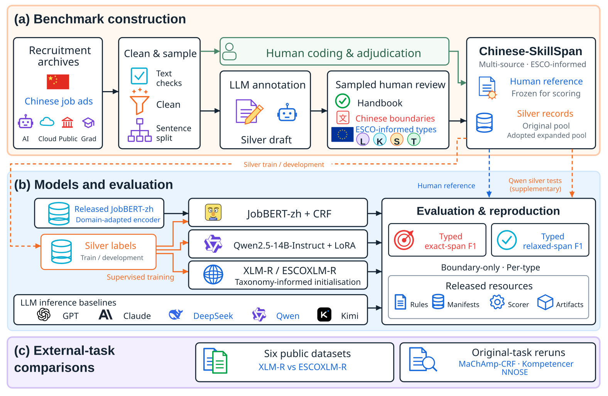

# Chinese-SkillSpan

A benchmark for competency span extraction in Chinese job advertisements, with annotation guidelines, Silver supervision, a human reference set, and evaluation tools.

Current manuscript: **Chinese-SkillSpan: a benchmark for competency span extraction in Chinese job advertisements**. [Read the manuscript and revision notes](reproduction/manuscript_revision_20261002/README.md).

An earlier preprint of this work is available as [arXiv:2604.23009v1](https://arxiv.org/abs/2604.23009v1). The present manuscript substantially revises its resource definitions, annotation procedures, and evaluation. The preprint describes an earlier stage of the study; its results and protocols should be interpreted in that version's context.

**[Data and access](DATA_AVAILABILITY.md) · [Reproduce results](REPRODUCIBILITY.md) · [Models](docs/models.md) · [Paper-to-file index](reproduction/PAPER_INDEX.md)**



Overview of Chinese-SkillSpan: (a) benchmark construction; (b) models and evaluation; and (c) external-task comparisons.

## What is included?

| Component | Size | Use |
|---|---:|---|
| Source corpus | 22,840 sentences | Four recruitment collections |
| Human reference set | 150 sentences, 663 spans | Frozen targets used in guideline development; diagnostic model evaluation |
| Original Silver pool | 2,451 records | Candidate supervision; experiment-specific inclusion |
| Silver training/development sets (Qwen and encoders) | 2,150 training / 169 development | Matched Qwen adaptation and encoder comparison |
| Silver training/development sets (JobBERT) | 2,156 training / 169 development | JobBERT-zh + CRF training and checkpoint selection |
| Adopted expanded Silver pool | 9,540 records | Includes earlier supervision; complete partitions are not publicly released |
| Alternative expanded Silver pool | 9,646 records | Overlapping supplementary configuration; complete partitions are not publicly released |
| Historical human coding and review | 500 unique sentences | Distinct cohorts for reference construction and quality checks |
| Blinded agreement sample | 50 sentences; three annotators | Three-annotator agreement; separate from historical coverage and not a model test set |

Human annotation and review cover 550 distinct sentences: 500 across reference construction and assisted reviews, plus 50 in the separate blinded agreement study. The study used the v4.2.14 handbook series. Three annotators independently labelled the separate 50-sentence sample in separate Doccano projects, with machine suggestions and one another's labels hidden throughout. They could consult the handbook and revise their own labels before submission; agreement was calculated from their final independent annotations, excluding familiarisation and practice sentences. The exact handbook file used for formal coding has not been established. Earlier exports and the documented coder revisions remain in the [annotation provenance record](reproduction/agreement/finalguide_abc_20261003/README.md); they are not a separate self-review stage or a consensus test set.

The [annotation and training guide](docs/terminology.md) explains the resource names and their relationships. [Annotation roles and sample membership](reproduction/reviewer_supplement_20261004/README.md) describe the human-reference and model-generated annotation layers. Manuscript numbers follow the [display-precision policy](docs/numerical_precision.md); source result files retain their original precision.

The task uses flat character spans with four types: language (L), knowledge-related requirements (K), occupational skills (S), and transversal competencies (T). The categories are ESCO-informed; the task does not assign ESCO concept IDs.

The authors confirm that the adopted Silver labels were generated through official OpenAI Codex, with the original annotation model recorded as `gpt-6-astra`. The alternative expanded annotation pool is retained only for supplementary comparison. DeepSeek and Kimi used official provider APIs. API baseline predictions were evaluated under a frozen protocol and checked by offline rescoring; recorded identifiers and access routes are listed in the [resource naming guide](PAPER_NAMES.md).

## Post-submission annotation maintenance

The [Blind-350 disagreement analysis](docs/annotation_disagreement_analysis_blind350.md) and [Blind-500 single-coder annotation draft](data/cnss_blind500_v1_coder_c_provisional_20261029/README.md) are later repository-maintenance materials. They were not used to train, select, or evaluate models, calculate results, or support claims reported in manuscript 149505.

The [Blind-350 package](data/cnss_blind350_v1_coders_bc_20261029/README.md) describes pre-adjudication differences between two independent coders; neither coder is treated as a reference standard. Blind-500 contains 500 confirmed sentences and 1300 spans from Coder C as a **provisional single-coder annotation draft pending independent second annotation and adjudication**, with agreement analysis still pending. Its [uncertainty review and future rule proposal](docs/uncertainty_blind500_20261029/README.md) are analytical working drafts, not adopted handbook changes. Keep the two cohorts separate; no combined 850-sentence release or new model evaluation is claimed.

The citable dataset associated with manuscript 149505 remains [Chinese-SkillSpan v0.1.3 on Zenodo](https://doi.org/10.5281/zenodo.22698504). These later materials do not change that archived dataset, the submitted manuscript or its reported results. They are distinct from the historical annotation coverage described above. [Third-party text conditions](DATA_AVAILABILITY.md#reuse-conditions) still apply.

## Get started

1. **Use the data:** download the [v0.1.3 archive](https://doi.org/10.5281/zenodo.22698504), then read the [human-reference guide](data/gold150/README.md) and [Chinese and English annotation handbooks](notes/handbooks/reader_20261007/README.md) (updated 7 October 2026).
2. **Inspect results:** open the [paper-to-file index](reproduction/PAPER_INDEX.md). It separates shared-guideline inference, supervised adaptation, and expanded-Silver experiments.
3. **Reproduce a score:** follow the [evaluation guide](reproduction/EVALUATION_ENTRY.md) with the matching protocol and saved predictions.
4. **Use a model:** see the [model guide](docs/models.md). The encoder and CRF checkpoint have separate loading requirements.

## Main adaptation result and supervised baseline

| Study | Comparison | Typed exact F1 on the human reference |
|---|---|---:|
| Qwen adaptation | No adapter → Qwen + LoRA | 0.3612 → 0.5403 ± 0.0354 |
| Silver-trained JobBERT baseline | JobBERT-zh + CRF; 2,156/169 training/development records | 0.5536 ± 0.0054 |

Training summaries are means and sample standard deviations across seeds 42, 43, and 44. The Qwen contrast uses fixed inference rules; the JobBERT row is the current supervised baseline. The full [historical JobBERT label-version comparison](reproduction/experimental_notes/jobbert_label_versions.md) remains available, including both scores and the changes to training and checkpoint-selection labels. Expanded-pool results and their access requirements are listed in the [expanded-study guide](reproduction/expanded_silver/README.md).

## Downloads and models

| Resource | Entry |
|---|---|
| Versioned data archive | [Zenodo v0.1.3](https://doi.org/10.5281/zenodo.22698504) |
| Qwen LoRA adapters and frozen predictions | [Qwen model-reproduction archive](https://doi.org/10.5281/zenodo.22851581) |
| Repository archive series | [Zenodo concept DOI](https://doi.org/10.5281/zenodo.22288337) |
| JobBERT-zh initialization | [Hugging Face model](https://huggingface.co/AlfredJames/jobbert-zh) |
| Silver-trained JobBERT-zh + CRF | [Hugging Face model](https://huggingface.co/AlfredJames/jobbert-zh-v6a) |
| Chinese-supervised XLM-R-large and ESCOXLM-R | [Model guide: three seeds per encoder](docs/models.md) · [Current audit archive](https://doi.org/10.5281/zenodo.22942441) |

Use the version-specific dataset DOI above for v0.1.3. The repository concept DOI currently resolves to the `qwen-repro-pack-20260919` snapshot, not the v0.1.3 dataset record. The archive covers the earlier released benchmark components. Later expansion materials on GitHub are partial; complete expanded training partitions are not supplied. Qwen adapters and frozen predictions are available in the separate model-reproduction archive. [Availability and licensing](DATA_AVAILABILITY.md) describes what readers can obtain and reuse.

The [4 October revision notes](reproduction/major_revision_20261004/README.md) document changes to the manuscript, data accounting, source-document analysis, and uncertainty estimates.

## Citation

For the 17 October code-materials addendum, use the [code citation metadata](reproduction/code_release_20261017/CITATION.cff), tag code-materials-20261017, and its resolved Git commit. The dataset DOI below identifies a different archived artifact.

Use the metadata in [CITATION.cff](CITATION.cff) and cite [Zenodo v0.1.3](https://doi.org/10.5281/zenodo.22698504) for that archived dataset version. This citation identifies the archived dataset version, whose release title is retained. The current manuscript title, PDF, and source revision are available in the [manuscript directory](reproduction/manuscript_revision_20261002/README.md).

Related English resource: Zhang et al. (2022), [SkillSpan](https://aclanthology.org/2022.naacl-main.366/).

## Responsible use

This resource supports analysis of recruitment text, not measurement or profiling of individual applicants. The selected human reference is not a random population sample. Source wording has separate reuse conditions from the software; see [LICENSE](LICENSE) and [data access](DATA_AVAILABILITY.md).

Supported by the National Social Science Fund of China, Grant No. 21BGL142.

Data provenance: [data sources and collection](docs/data_sources.md).


## Code information and requirements

See the [17 October code release scope](reproduction/code_release_20261017/README.md) for the entry-point inventory, retained evidence and explicit unresolved items.

The current human-reference evaluation is implemented by `scripts/eval_gold150_ext.py`, with in-memory reference conversion in `scripts/convert_gold150_to_bio.py` and the frozen scorer in `scorer/score_lskt.py`. Typed exact-span micro F1 is the primary measure. Character offsets are half-open Unicode-code-point offsets; relaxed matching uses same-type greedy one-to-one matching at IoU >= 0.5. See the [evaluation guide](reproduction/EVALUATION_ENTRY.md) before selecting predictions.

The scorer, reference converter, and companion validator use the Python standard library. A targeted CPU audit was run with Python 3.12.14 on Windows 11; this describes the audit environment, not the original training infrastructure. Optional historical word-segmentation evaluation requires `jieba>=0.42.1`, listed in `requirements-repro.txt`. Encoder prediction rescoring additionally requires NumPy. The historical encoder/CRF recipe is in `requirements-train.txt`; it is not a complete Qwen environment lock. Qwen shared-guideline loading and execution must follow the [separate model archive](https://doi.org/10.5281/zenodo.22851581). The Chinese encoder and A-native archives include software and GPU records; historical operating-system and several JobBERT/Qwen runtime fields remain incomplete. These records are experiment-specific and must not be replaced by the dependency recipe for another experiment.

```bash
# Run from the repository root; these commands make no model call.
python scorer/score_lskt.py --help
python scripts/eval_gold150_ext.py --help
python reproduction/verify_companion.py
# Only if running historical segmentation-dependent evaluation:
python -m pip install -r requirements-repro.txt
```

Companion checksums describe the archived file bytes. Use an archive download, or clone with `git -c core.autocrlf=false clone https://github.com/AlfredJamesLi/chinese-skillspan-benchmark.git`, to preserve line endings on Windows. Changing line endings changes these hashes.

The companion validator checks recorded files and arithmetic, not model predictions. Its manifest must correspond to the selected repository revision; do not ignore a checksum failure. Scoring saved predictions additionally requires the exact input file listed for that experiment. The [evaluation guide](reproduction/EVALUATION_ENTRY.md) documents the scoring command and the [model guide](docs/models.md) identifies separately distributed artifacts.

### Experiment code and retained records

| Experiment | Published entry and scope |
|---|---|
| JobBERT-zh domain pretraining | [`train_jobbert_zh_mlm.py`](scripts/train_jobbert_zh_mlm.py), [`jobbert_zh_3m.sbatch`](scripts/jobbert_zh_3m.sbatch) and [`export_jobbert_mlm_encoder.py`](scripts/export_jobbert_mlm_encoder.py) provide training and export code. |
| JobBERT-zh + CRF | [`train_cn_roberta_crf.py`](scripts/train_cn_roberta_crf.py) provides the general CRF implementation. The five continuation entries are present in the [fixed source snapshot `912a8f5`](https://github.com/AlfredJamesLi/chinese-skillspan-benchmark/tree/912a8f5108105791f3d80cb3c719de6f24b61b8a/reproduction/server_b_code_addendum_20261017/original/jobbert_continuation/scripts): `phase4_v6_jobbert.sbatch`, `run_phase4_v6_jobbert12.sh`, `train_jobbert_phase1.py`, `infer_jobbert_phase1.py`, and `eval_gold150_phase1.py`. They are absent from the current main tree, so delivery into main remains unresolved. [`train_jobbert_ext.py`](scripts/train_jobbert_ext.py) remains a separate fresh-head comparison. |
| Shared-guideline Qwen B2 and two expanded pools | The [Qwen release](https://github.com/AlfredJamesLi/chinese-skillspan-benchmark/releases/tag/qwen-repro-pack-20260919) contains `CNSS_Qwen_Reproduction.zip`, including actual training, inference/evaluation and helper scripts under `shared_guidelines_b2/scripts/` and `expanded_silver/{codex,proxy}_seed42/scripts/`. The [pinned model index](https://github.com/AlfredJamesLi/chinese-skillspan-benchmark/blob/d258d4937b0fd7adf976d5facee257c31af770d1/docs/codex_qwen_repro_20260919/MODEL_INDEX.csv) maps the published configurations. |
| Qwen without an adapter | Frozen predictions, prompts, parser and configuration are published in main. The [fixed source snapshot `912a8f5`](https://github.com/AlfredJamesLi/chinese-skillspan-benchmark/tree/912a8f5108105791f3d80cb3c719de6f24b61b8a/reproduction/code_release_20261017/qwen_no_adapter_shared_guidelines/scripts) contains `run_qwen_worker.py`, `gold150_qwen.sbatch`, `gold150_qwen_shard1.sbatch` and `merge_qwen_shards.py`; these generation entries are absent from the current main tree. The adapter-required B2 script is not a substitute. |
| Chinese XLM-R / ESCOXLM-R | The [pinned encoder audit](https://github.com/AlfredJamesLi/chinese-skillspan-benchmark/tree/0c73207c0f9b00fa87f385b78bcb7342bd00bfcb/results_snapshots/table11_evidence_20260924) contains `code/run_chinese_encoder.py`, adapters, launch scripts, six run configurations and `env/ENV_RECORD.txt`. |
| External common-protocol experiments | [Retained implementation, source manifests and usage](reproduction/external_common_code_20261017/README.md) are now included. The 48-run matrix and recorded revisions match the public receipts; final server-source byte identity remains unverified. This is not a native-task reproduction. |
| Native SkillSpan / Gnehm | [`run_remaining_today.py`](https://github.com/AlfredJamesLi/chinese-skillspan-benchmark/blob/0c73207c0f9b00fa87f385b78bcb7342bd00bfcb/results_snapshots/table11_evidence_20260924/code/scripts/run_remaining_today.py) contains the training, prediction, scoring and scheduling functions. Its upstream revision and referenced native configurations/patches still need to be supplied. |
| Native Kompetencer / NNOSE | The [pinned A-native archive](https://github.com/AlfredJamesLi/chinese-skillspan-benchmark/tree/b84f218b7142c97ab03a60499a9b30e7ec332cab/results_snapshots/a_native_20260924) contains the completion receipt, software/GPU environment, model revisions, predictions and metrics. Project-specific launch configurations and compatibility patches still need to be supplied. |

Source recovery in the fixed snapshot is not a new end-to-end reproduction. Historical environment records and native-task configurations/compatibility patches remain incomplete; the snapshot is not an ancestor of the current main revision inspected for this update.

The Qwen source has been published, but some scripts retain laboratory-specific paths to the base model, reference and run directories. Resolve those paths against the package contents before execution. Complete expanded-Silver training texts are not included. `scripts/train_qwen_ext_sft.py` and `scripts/infer_qwen_ext_sft.py` in the main repository implement the earlier JSON-offset protocol and must not replace the shared-guideline experiment. Publication of source files is distinct from a verified end-to-end training rerun; the checks run for this code release are recorded in [VALIDATION.json](reproduction/code_release_20261017/VALIDATION.json). They did not run models or rescore predictions.

## Methodology and data access

The workflow combines source collection and preprocessing, frozen human-reference annotation, generated Silver supervision, experiment-specific training/development partitions, and evaluation under fixed prompts, parsing rules and scoring. [Data sources](docs/data_sources.md), [annotation guides](notes/handbooks/README.md), and the [paper-to-file index](reproduction/PAPER_INDEX.md) document the corresponding stages. Do not regenerate labels or repartition data when checking an archived score. The 2,150-row Qwen/encoder training file is not the 2,156-row JobBERT training manifest.

The complete MacroData vendor exports and complete expanded-Silver training partitions are not supplied for public redistribution. Availability of derived research materials does not grant rights over the underlying recruitment text. [DATA_AVAILABILITY.md](DATA_AVAILABILITY.md) records the scope and access conditions; use the original source URLs for third-party attribution.

## License and contributions

The scorer, advertised project scripts and original documentation are covered by Apache-2.0 as specified in [LICENSE](LICENSE). Annotations, source recruitment text and model artifacts have component-specific terms. See [CONTRIBUTING.md](CONTRIBUTING.md) for issue reports and contributions. Include the repository commit, exact command, Python/package versions and input hashes, and use synthetic examples when reporting data or scoring problems. Changes to frozen references, splits or scoring contracts require a separately versioned protocol and a record of affected results.
